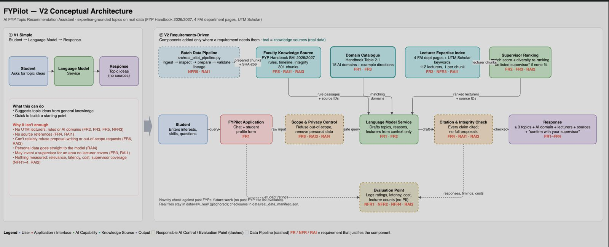
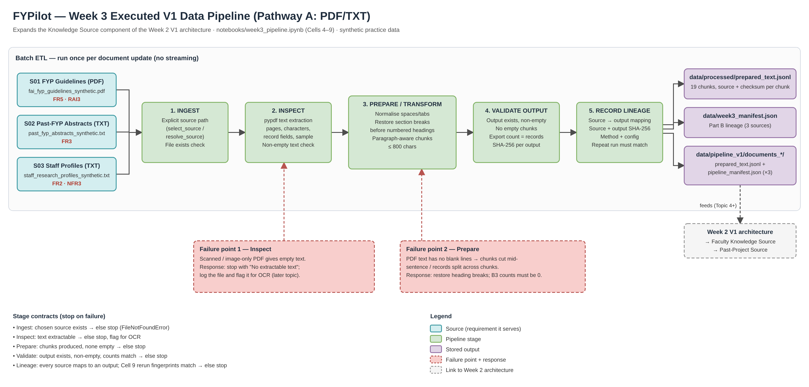

# FYPilot — AI FYP Topic Recommendation Assistant

> A document-grounded AI assistant that recommends final year project (FYP) topics and matching supervisors for UTM Faculty of AI undergraduates, based on their interests, skills and official faculty documents.

## Problem Statement

Final-year students struggle to choose a suitable, feasible FYP topic and a matching supervisor, because the FYP rules, AI topic domains and lecturer research areas are scattered across a long handbook and separate department and profile pages, and supervisors have limited time for one-to-one consultation. General-purpose chatbots can suggest ideas, but they are not grounded in the faculty's real supervisors or rules. AI engineering makes it possible to build a retrieval-augmented (RAG) assistant that recommends topics grounded in what the faculty's lecturers actually research, explains them using official documents, and cites every source.

## Evidence of the Problem

- A survey of 150 undergraduates found about 40% were unhappy or mixed about how they chose their final-year project, and some felt unprepared or had too little information to choose well — Winder, I. C. (2023), *Choice matters: an investigation of students' experiences selecting dissertation projects*, Journal of Learning Development in Higher Education, Issue 27. [Link](https://distantreader.org/stacks/journals/jldhe/jldhe-923.pdf)
- Final-year students struggle to find suitable supervisors because they often don't know lecturers' areas of expertise, which can lead to project titles that don't match their interests — Ismail, M. H., Razak, T. R., Hashim, M. A., & Ibrahim, A. F., *A Simple Recommender Engine for Matching Final-Year Project Student with Supervisor*, UiTM Perlis. [Link](https://arxiv.org/abs/1908.03475)
- Choosing an appropriate thesis topic is challenging when it doesn't match a student's skills, interests and experience — Maazzalla, A., & Perkasa, E. B. (2026), *Design of a Student Thesis Topic Recommendation System Using the K-Nearest Neighbor Algorithm*, IJSECS 6(2), 705–714. [Link](https://journal.lembagakita.com/ijsecs/article/download/7659/5032)

## Initial Related Work / Existing Approaches

- **Supervisor recommender engine** — rates a student's interest in fixed areas (e.g. Multimedia, Network, AI) and returns lecturers with similar profiles ([Link](https://arxiv.org/abs/1908.03475)). *Limitation:* matches supervisors only by a few fixed categories; it does not suggest specific topics, read faculty documents, or explain its recommendations.
- **KNN thesis topic recommender** — classifies students into topic areas from their skills, interests and experience ([Link](https://journal.lembagakita.com/ijsecs/article/download/7659/5032)). *Limitation:* only four broad areas, a small dataset (25 respondents, 5 test cases), and no grounding in supervisors, faculty documents or citations.
- **TeamUp: semantic project matching** — embeds student profiles and project descriptions with pretrained language models and ranks projects by cosine similarity, adjusted for difficulty and supervisor demand ([Link](https://arxiv.org/abs/2605.03237)). *Limitation:* matches students to a fixed list of existing projects rather than helping them form a new topic; evaluated only on synthetic data (250 dummy students), with no citations to source documents and no link to the expertise of real supervisors.

## Project Objectives

- **O1:** To design a document-grounded AI assistant that recommends FYP topics and matching supervisors using official faculty documents and lecturer profiles.
- **O2:** To develop the solution using retrieval-augmented generation (RAG) over faculty documents and lecturer expertise, with source citations and scope and privacy guardrails.
- **O3:** To evaluate the solution in terms of recommendation relevance, supervisor match, groundedness (citation accuracy), topic–expertise grounding, latency, cost and Responsible AI safety (refusal, privacy and supervisor coverage).

## Target Users

Undergraduate students at UTM's Faculty of Artificial Intelligence who are about to choose their FYP topic and supervisor, especially those who are unsure which research area suits their interests and skills or which lecturer supervises it.

## Data Sources

- **S01 — FYP Handbook BAI 2026/2027** (FAI FYP Committee, PDF, 119 pages) — FYP rules, timeline, assessment, academic integrity. Internal document: kept locally, not in this repo.
- **S02 — Handbook Table 2.1: AI domains, topics and example FYP directions** (15 domains) — the domain frame for topic suggestions.
- **S03 — Lecturer expertise:** the four FAI department staff pages (https://fai.utm.my — Intelligence Informatics, Smart Engineering and Advanced Technology, Business Intelligence Humanities and Governance, Creative AI) merged with research keywords from UTM Scholar (https://utmscholar.utm.my).

Real files live in `data/raw_real/` (gitignored); checksums and counts are in [`data/real_data_manifest.json`](data/real_data_manifest.json) and are rebuilt by [`src/real_pilot_pipeline.py`](src/real_pilot_pipeline.py). The synthetic Week 3 practice files stay in `data/raw/` as evidence. A novelty check against past FYPs is future work: no past-FYP title list is available.

## Documentation

- [Week 1 — Project Scope](docs/week1_project_scope.md)
- [Week 2 — Requirements (FR, NFR, RAI)](docs/week2_requirements.md)
- [Week 2 — Evaluation Criteria](docs/week2_evaluation_criteria.md)
- [Week 2 — Architecture Decisions & Traceability](docs/week2_architecture_decisions.md)
- [Week 3 — Data Inventory](docs/week3_data_inventory.md)
- [Week 3 — Pipeline Decisions & Stage Contracts](docs/week3_pipeline_decisions.md)
- [Week 3 — V1 Data Pipeline Notebook](notebooks/week3_pipeline.ipynb)
- [Week 4 — Data Quality & Bias Report](docs/week4_data_quality_report.md)
- [Week 4 — Real-data pilot pipeline](src/real_pilot_pipeline.py)
- [Week 4 — V2 architecture diagram](docs/week4_architecture_v2.jpg) (V1: [week2_architecture_v1.png](docs/week2_architecture_v1.png))

## Weekly Progress

| Week | Focus | Deliverable | Status |
|------|-------|-------------|--------|
| W1 | System map + project scope | README + docs | ✅ |
| W2 | Requirements, evaluation criteria + V1 architecture | docs/week2_*.md + architecture diagram | ✅ |
| W3 | V1 data pipeline (PDF/TXT, synthetic practice data) | notebook + data inventory + pipeline diagram + prepared data & manifests | ✅ |
| W4 | Data quality & bias audit | docs/week4_data_quality_report.md | ✅ |

## Week 4 Quality Gate

**GO WITH CONDITIONS.** Synthetic practice data: V1 passed 19 of 19, V2 found 2 of 3 staff chunks holding two lecturers. Real-data pilot (FYP handbook 2026/2027 + all four FAI department staff pages merged with UTM Scholar keywords, kept locally in `data/raw_real/`, checksums in `data/real_data_manifest.json`): V1 passed 431 of 431, V2 passed 115 of 115, page kept on 316 of 316 PDF chunks.

Unresolved actions:
- Lecturer expertise: UTM Scholar raised AI-related lecturers from 20 to 39 (of 115), but no lecturer lists generative AI (only 4 NLP); review the 12 unmatched Scholar records and request the FYP Committee topic list.
- Novelty check against past FYPs moved to future work (needs a past-FYP title list from the FYP Committee).
- Confirm the duplicate staff entry with the department.
- Re-run `notebooks/week3_pipeline.ipynb` inside Colab.
