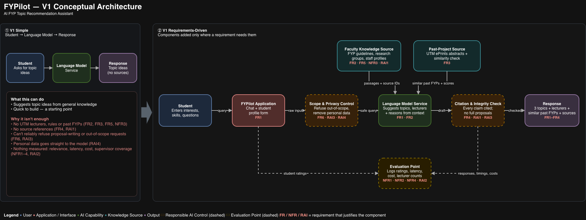

# FYPilot — AI FYP Topic Recommendation Assistant

> A document-grounded AI assistant that recommends final year project (FYP) topics and matching supervisors for UTM Faculty of AI undergraduates, based on their interests, skills and official faculty documents.

## Problem Statement

Final-year students struggle to choose a suitable, feasible FYP topic and a matching supervisor, because topic lists, lecturer research areas and past project titles are scattered across separate PDFs and web pages, and supervisors have limited time for one-to-one consultation. General-purpose chatbots can suggest ideas, but they are not grounded in the faculty's real supervisors, rules or past projects. AI engineering makes it possible to build a retrieval-augmented (RAG) assistant that recommends and explains topics using official documents, with citations, guardrails and a novelty check against previous FYPs.

## Evidence of the Problem

- A survey of 150 undergraduates found about 40% were unhappy or mixed about how they chose their final-year project, and some felt unprepared or had too little information to choose well — Winder, I. C. (2023), *Choice matters: an investigation of students' experiences selecting dissertation projects*, Journal of Learning Development in Higher Education, Issue 27. [Link](https://distantreader.org/stacks/journals/jldhe/jldhe-923.pdf)
- Final-year students struggle to find suitable supervisors because they often don't know lecturers' areas of expertise, which can lead to project titles that don't match their interests — Ismail, M. H., Razak, T. R., Hashim, M. A., & Ibrahim, A. F., *A Simple Recommender Engine for Matching Final-Year Project Student with Supervisor*, UiTM Perlis. [Link](https://arxiv.org/abs/1908.03475)
- Choosing an appropriate thesis topic is challenging when it doesn't match a student's skills, interests and experience — Maazzalla, A., & Perkasa, E. B. (2026), *Design of a Student Thesis Topic Recommendation System Using the K-Nearest Neighbor Algorithm*, IJSECS 6(2), 705–714. [Link](https://journal.lembagakita.com/ijsecs/article/download/7659/5032)

## Initial Related Work / Existing Approaches

- **Supervisor recommender engine** — rates a student's interest in fixed areas (e.g. Multimedia, Network, AI) and returns lecturers with similar profiles ([Link](https://arxiv.org/abs/1908.03475)). *Limitation:* matches supervisors only by a few fixed categories; it does not suggest specific topics, read faculty documents, or explain its recommendations.
- **KNN thesis topic recommender** — classifies students into topic areas from their skills, interests and experience ([Link](https://journal.lembagakita.com/ijsecs/article/download/7659/5032)). *Limitation:* only four broad areas, a small dataset (25 respondents, 5 test cases), and no grounding in supervisors, past projects or citations.
- **TeamUp: semantic project matching** — embeds student profiles and project descriptions with pretrained language models and ranks projects by cosine similarity, adjusted for difficulty and supervisor demand ([Link](https://arxiv.org/abs/2605.03237)). *Limitation:* matches students to a fixed list of existing projects rather than helping them form a new topic; evaluated only on synthetic data (250 dummy students), with no citations to source documents or novelty check against past projects.

## Project Objectives

- **O1:** To design a document-grounded AI assistant that recommends FYP topics and matching supervisors using official faculty and repository documents.
- **O2:** To develop the solution using retrieval-augmented generation (RAG) with hybrid search, source citations, a past-project similarity check, and guardrails.
- **O3:** To evaluate the solution in terms of recommendation relevance, groundedness (citation accuracy), novelty against past FYPs, latency, and safety.

## Target Users

Undergraduate students at UTM's Faculty of Artificial Intelligence who are about to choose their FYP topic and supervisor, especially those who are unsure which research area suits their interests and skills or which lecturer supervises it.

## Data Sources

- **Source 1:** FAI FYP Guidelines (UTM Faculty of AI FYP site) — scope rules, timeline, assessment criteria — https://sites.google.com/utm.my/fai-fyp/home
- **Source 2:** UTM Institutional Repository — past project and thesis abstracts for topic inspiration and novelty checks — https://eprints.utm.my
- **Source 3:** UTM Faculty of Artificial Intelligence — departments and research groups — https://fai.utm.my
- **Source 4:** UTM staff profile pages — lecturer research expertise for supervisor matching — https://people.utm.my

## Documentation

- [Week 1 — Project Scope](docs/week1_project_scope.md)
- [Week 2 — Requirements (FR, NFR, RAI)](docs/week2_requirements.md)
- [Week 2 — Evaluation Criteria](docs/week2_evaluation_criteria.md)
- [Week 2 — Architecture Decisions & Traceability](docs/week2_architecture_decisions.md)

## Weekly Progress

| Week | Focus | Deliverable | Status |
|------|-------|-------------|--------|
| W1 | System map + project scope | README + docs | ✅ |
| W2 | Requirements, evaluation criteria + V1 architecture | docs/week2_*.md + architecture diagram | ✅ |
